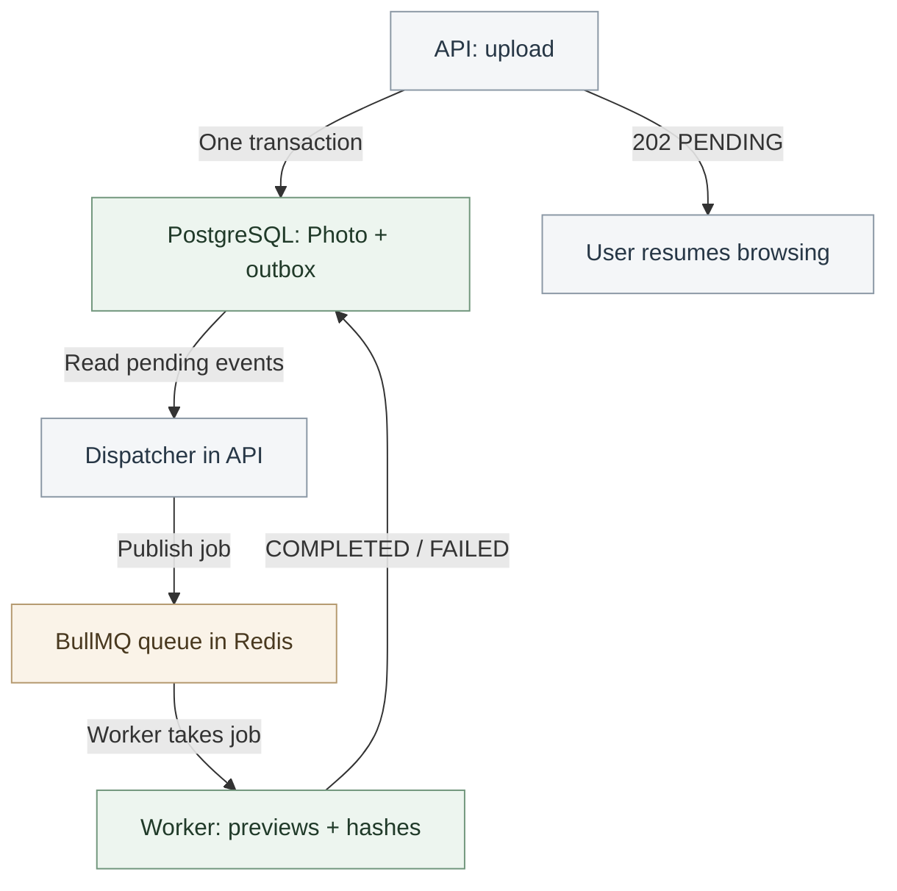

# Application and photo processing

**What is it?** React Router renders the Web application; Fastify serves HTTP
and Better Auth handles email/password sessions backed by Prisma/PostgreSQL.
Redis is an in-memory data store; BullMQ uses it as a durable job queue with
retries, rather than as a photo cache.

**Why Clichy uses it** HTTP requests record work quickly, while an independent
worker performs CPU-intensive image decoding and produces previews.

## Upload to completion

The API responds after saving the original and committing Photo + outbox, without
waiting for image processing. Redis holds jobs, not photo files; the worker reads
the shared photos volume. The dispatcher retries unpublished events. Queue identity makes repeated
publication idempotent; worker claims prevent duplicate processing. Queue
defaults are four attempts with exponential backoff from two seconds. Invalid
images and missing originals fail permanently. Stale `PROCESSING` records are
recovered after 15 minutes and stale `PENDING` records after 10 minutes; normal
SIGTERM lets the worker close within its 120-second Kubernetes grace period.

The original is written before the transaction. A process crash in that window
can leave an orphan file; there is no orphan sweeper. Files and metadata must
be backed up together. Redis AOF improves persistence but is not replication
or a backup of the library.

## API and storage

The API accepts JPEG, PNG, WebP and GIF, with a 20 MiB multipart limit and a
40-million-pixel decoder cap. Sharp creates WebP previews, Exifr reads optional
EXIF, SHA-256 identifies exact duplicates, and a 64-bit DCT pHash ranks similar
images by Hamming distance. These queries do not imply a complete duplicate
review or blurry-photo classification UI.

| Route | Purpose |
| --- | --- |
| `/api/auth/*` | Better Auth sessions and registration |
| `GET /photos`, `POST /photos` | Owned photo list and upload |
| `GET /photos/:id` | Original |
| `GET /photos/:id/metadata` | Metadata |
| `GET /photos/:id/thumbnail/:variant` | Preview |
| `GET /photos/:id/duplicates`, `/similar` | Owned duplicate/similarity queries |
| `DELETE /photos/:id` | Owned record and file removal |

The API serves health at `/` and metrics at `/metrics`. Worker exposes `/live`,
`/ready` and `/metrics` on port 3001; readiness requires Redis. Queue/storage
configuration comes from the environment schemas; API and worker must agree.
The backfill command reschedules incomplete photos across the library and
therefore belongs to maintenance, not healthchecking.
