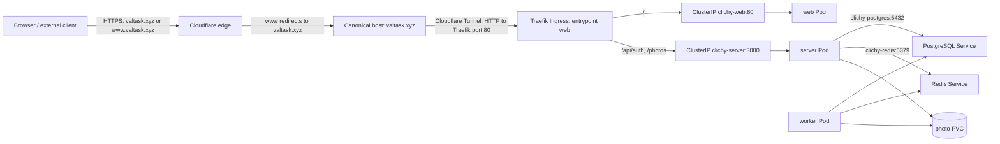

# Networking and request flow

The base Ingress uses Traefik class and the `web` entrypoint. It sends `/api/auth` and `/photos` to the API and `/` to web. Environment overlays change the hostname: `clichy.localhost` (Dev), `clichy-test.home.arpa` (Test), `valtask.xyz` (Production). In Production, the externally configured Cloudflare Tunnel forwards `valtask.xyz` over HTTP to Traefik on port 80; Cloudflare terminates public HTTPS. Cloudflare redirects `www.valtask.xyz` to `https://valtask.xyz`, so the Kubernetes Ingress only needs the canonical `valtask.xyz` host. Tunnel and redirect configuration are outside this repository. The repo's current base ingress annotation selects `web`; TLS configuration is not present in that Ingress.

Services use namespace-local DNS names (`clichy-postgres`, `clichy-redis`, `clichy-server`, `clichy-web`). PostgreSQL and Redis are ClusterIP internal services; no public database/Redis ingress or service is configured. For local access, use the documented ingress route or explicit `kubectl port-forward` only when needed.

## Network diagram caveat

The separate Ingress resources for Grafana and Headlamp are under `infra/kubernetes/monitoring` and `infra/kubernetes/headlamp`; they are LAN-oriented configuration. They are not included in the application Ingress and are not exposed by the documented Cloudflare Tunnel. Check their host/entrypoint and cluster DNS before assuming reachability.
