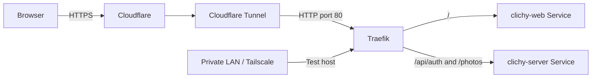

# Networking

## Traefik and Ingress

**What is it?** A Kubernetes Ingress declares HTTP routing by host and path.
Traefik is the Ingress Controller that implements those rules.

**Why Clichy uses it** One application endpoint routes the browser UI and API
to separate internal Services without exposing databases or Redis.

| Environment | Host | Intended access |
| --- | --- | --- |
| Dev | `clichy.localhost` | Local Kubernetes only |
| Test | `clichy-test.home.arpa` | Private LAN/Tailscale |
| Production | `valtask.xyz` | Public tunnel |

Base Ingress uses class `traefik`, entrypoint `web`, UI `/`, API `/api/auth`
and `/photos`. Namespace-local ClusterIP Services expose Web, API, Redis and
the environment database. `/metrics` is not routed publicly by this Ingress.

## Cloudflare Tunnel

**What is it?** `cloudflared` opens an outbound connection to Cloudflare,
allowing public HTTP traffic to reach a private server without inbound home
router forwarding.

**Why Clichy uses it** Only Production is public. Cloudflare terminates HTTPS,
redirects `www.valtask.xyz` to `valtask.xyz` and forwards the canonical route to
Traefik over the tunnel. DNS, redirects and tunnel settings are outside Git.

Grafana (`http://valtask:3000`) and Headlamp (`http://valtask:4466`) use separate
LAN entrypoints. They must remain private. Traefik ports are not automatically
bound only to Tailscale; restrict access through the host firewall and verify
existing SSH access before changing rules. See [server setup](../infrastructure/kubernetes.md).
