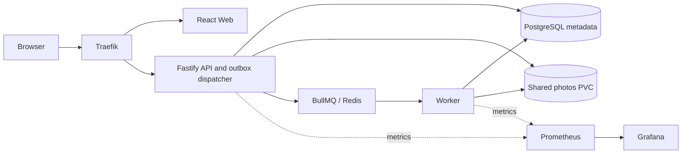

# Architecture

**What is it?** Clichy separates browser UI, HTTP API and asynchronous image
processing. PostgreSQL stores records; a filesystem stores image bytes.

**Why Clichy uses it** Uploads can return promptly while a separate worker
processes durable work independently of HTTP requests.

Web calls the authenticated API. API and worker mount the same photo volume at
`/data/photos`. The API writes a Photo and an outbox event in one transaction;
the dispatcher publishes that event to BullMQ. Worker jobs carry `photoId` and
`userId`; queries include the owner/shard key.

| Component | Source | Responsibility |
| --- | --- | --- |
| Web | `apps/web` | Login, dashboard and photo UI |
| API | `apps/server` | Authentication, uploads, photo queries and outbox dispatch |
| Worker | `apps/worker` | Metadata, hashes and preview generation |
| Shared packages | `packages/db`, `auth`, `jobs`, `ui` | Prisma, Better Auth, queue configuration and UI components |

The target Test/Production database is one CNPG primary with local Citus shards
and one WAL standby, accessed through `clichy-postgres-rw`. Dev remains plain
CNPG. The [database guide](../infrastructure/databases.md) distinguishes this
repository target from the observed pre-cutover topology; the controlled migration
preserves Test's separate existing dataset.

Namespaces isolate configuration and resources on one physical K3s host.
Redis remains one instance per namespace. Shards, replicas and extra application
Pods do not provide physical capacity scaling or host-level availability.
