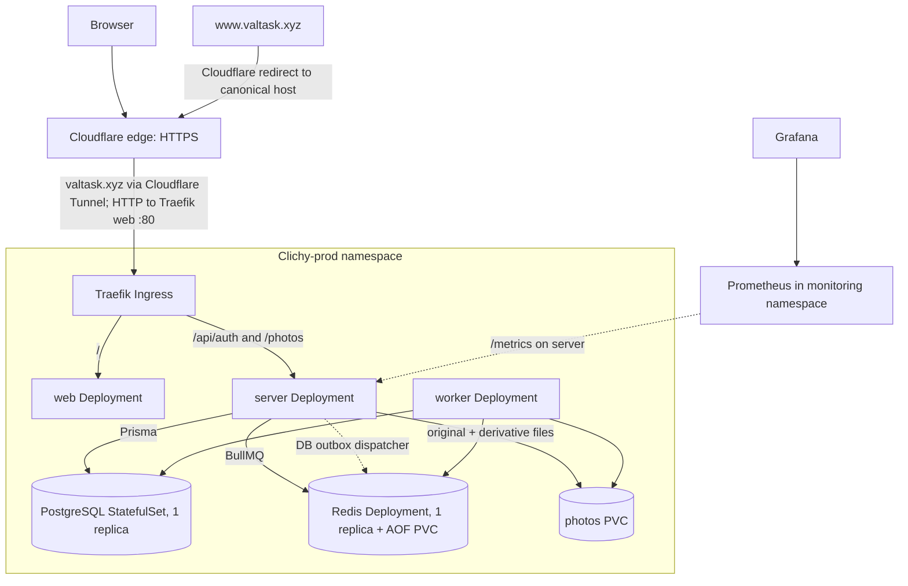

# System architecture

## Current deployment view

The public Production request path begins at Cloudflare. HTTPS terminates there, then the Cloudflare Tunnel forwards HTTP to Traefik's `web` entrypoint on port 80. `www.valtask.xyz` is redirected by Cloudflare to `valtask.xyz`; the application Ingress host is `valtask.xyz`. The tunnel and redirect rules are configured outside this repository. Traefik then routes the UI and API paths to their in-cluster Services.

The server is both the HTTP API and outbox dispatcher. It constructs the BullMQ queue and periodically dispatches pending outbox entries. Worker instances consume `process-photo` jobs. The API and worker need the same photo files; Kubernetes mounts the photos PVC into both Deployments.

## Namespace interpretation

The repository defines `clichy-dev`, `clichy-test`, and `clichy-prod`; monitoring and Headlamp are separate cluster-level installations/namespaces. These are namespace boundaries on one cluster, not separate clusters. Base resources include a PostgreSQL StatefulSet and Redis Deployment; each overlay sets independent configuration and app Secrets.

## Limits

Current manifests configure one server, web, worker, PostgreSQL, and Redis replica by default (Test has an HPA for server/web). PostgreSQL and Redis are single-instance services. No replication or sharding is configured. The underlying production local PVs are node-affine and do not provide node-level storage failover. No cluster or live traffic test was performed for this documentation pass.
