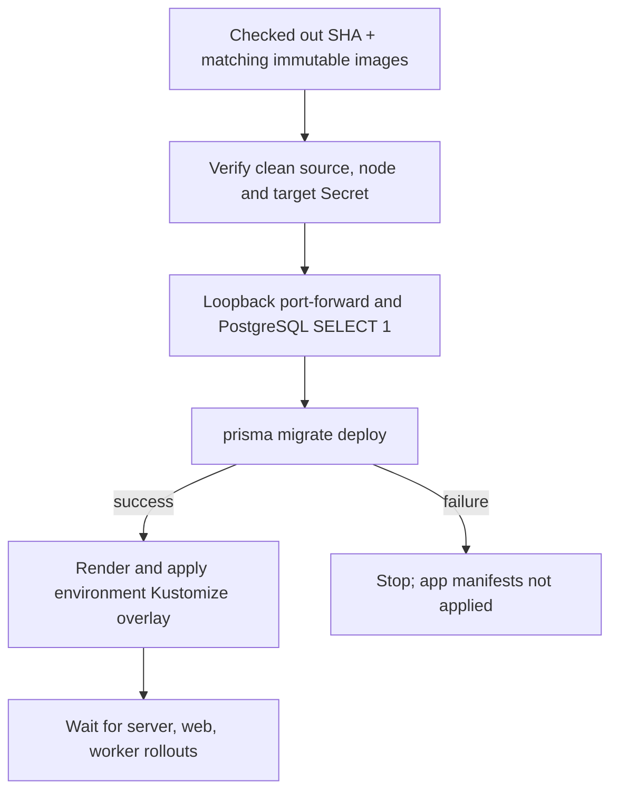

# Prisma schema migrations

## Local workflow

Edit the Prisma schema, then use:

```bash
pnpm db:generate
pnpm db:migrate
```

The root `db:migrate` delegates to `@clichy/db` and runs `prisma migrate dev`; it can create a migration and prompt in development. Review and commit the generated SQL under `packages/db/prisma/migrations` with the schema change. `pnpm db:push` is available but bypasses migration history; do not use it for production changes.

Inspect migration state:

```bash
pnpm --filter @clichy/db exec prisma migrate status
./infra/kubernetes/scripts/migrate.sh test status
./infra/kubernetes/scripts/migrate.sh prod status
```

The environment script uses the namespace Secret and loopback port-forward. It does not print the DB URL. Running status can return nonzero when migrations are pending.

## Deployment ordering



The workflow applies migrations before deploying the matching app images. The migration script confirms the target database name (`clichy_test` or `clichy_prod`) from the connection URL and checks commit cleanliness for relevant sources. Because old Pods may serve while DDL runs, use backward-compatible expand-and-contract migrations. No transactional rollback or automatic schema rollback is provided; Prisma migration failures require diagnosis and a forward repair plan.
