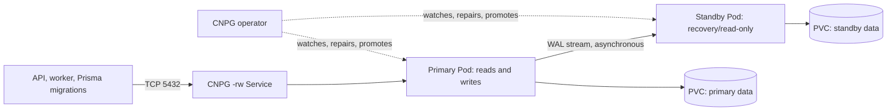

# Database replication status

## Current state

CloudNativePG (CNPG) is configured for two PostgreSQL 18.6 instances in each app namespace. In Production on `valtask`, the cluster has been observed Ready with two running instances, and the application database connection has been restored. The primary/standby roles and WAL streaming are configured, but the evidence collected so far does not include a live `pg_stat_replication` result or a failover test. Dev and Test live status should be checked separately.

The old PostgreSQL StatefulSet is no longer included in the environment overlays. Its existing production PV and data directory are retained and are not reused by CNPG. CNPG provisions one independent PVC per instance. Production uses two pre-bound, retained local PVs; Dev and Test use K3s `local-path` dynamic provisioning. The operator affinity retains preferred anti-affinity, allowing both instances on this one-node cluster while still preferring separation if nodes are added later.

## Architecture and WAL flow



CNPG configures and supervises the PostgreSQL instances; PostgreSQL itself streams write-ahead log (WAL) records from the primary and replays them on the standby. Asynchronous replication is selected (`minSyncReplicas: 0`, `maxSyncReplicas: 0`): writes do not wait for standby acknowledgement, so a sudden primary loss can lose the most recent unreceived transactions. Synchronous replication waits for configured standbys and can reduce that loss window, but adds write latency and can block writes when acknowledgers are unavailable; it is not enabled here.

CNPG runs a controller in `cnpg-system`, exposes `clichy-postgres-rw` and read-only `-ro`/`-r` role services, and reconciles the cluster resource. The app uses only `-rw`; no replica read routing is configured. CNPG promotes an eligible standby after it determines the primary has failed, updates the role service, and recreates/rejoins the former primary as a standby when possible. A deliberate Pod deletion tests the controller's Pod failure recovery path, but it is not equivalent to loss of the node or a controlled PostgreSQL shutdown.

This single-node prototype does not protect against power, disk, OS, K3s, or physical server failure. Replication is not a backup: accidental deletes and logical corruption can be replayed. Keep backups and tested restore as separate work.

## Install and inspect

The pinned operator installer is `infra/kubernetes/cnpg/install-operator.sh`. CNPG 1.30.1 officially supports Kubernetes 1.34–1.36; its release is tested but not officially supported on 1.37. The project K3s installer currently targets 1.37, so check the live server version first. The script refuses 1.37 unless the operator explicitly opts in with `CNPG_ALLOW_TESTED_UNSUPPORTED_K8S=1`; K3s distribution support is also outside CNPG's formal vanilla-Kubernetes support policy. Do not interpret successful install as upstream support.

On `valtask`, from a clean checkout of this repository, check `kubectl version -o json` and `/srv/clichy` free space first. The supplied host report had 28 GiB free on that 30 GiB filesystem; the new two 2 GiB CNPG volumes are separate from the retained legacy volume. Then install the operator once:

```sh
# For Kubernetes 1.34–1.36:
./infra/kubernetes/cnpg/install-operator.sh

# Only if the actual server reports Kubernetes 1.37 and you accept the
# tested-but-not-supported status:
CNPG_ALLOW_TESTED_UNSUPPORTED_K8S=1 ./infra/kubernetes/cnpg/install-operator.sh
```

The installation creates the `cnpg-system` namespace, CRDs, RBAC and operator Deployment. Next, create fresh empty DB clusters and credentials; this prepares secrets, local PV directories for Prod, and CNPG resources, but does not remove or import legacy database contents:

```sh
./infra/kubernetes/scripts/prepare-namespace.sh test
./infra/kubernetes/scripts/prepare-namespace.sh dev
./infra/kubernetes/scripts/prepare-namespace.sh prod
```

Each script prompts before changing its namespace and may prompt for GHCR credentials if needed. The Prod run creates `/srv/clichy/k3s-storage/prod/postgres-cnpg-1` and `-2` only when absent/empty, sets UID/GID 26 on new paths, and retains `/srv/clichy/k3s-storage/prod/postgres`. Once Test is Ready, push the reviewed commit through the ordinary pipeline: CI runs tests/builds, deploys Test, and the configured Production environment gate controls Prod promotion. `deploy.sh` refuses to migrate or deploy until CNPG reports Ready.

After operator install and namespace preparation, inspect roles and PVCs:

```sh
kubectl get cluster,pods,svc,pvc -n clichy-prod -o wide
kubectl get pods -n clichy-prod -l cnpg.io/cluster=clichy-postgres -L cnpg.io/instanceRole
kubectl get endpointslice -n clichy-prod -l kubernetes.io/service-name=clichy-postgres-rw
kubectl describe cluster clichy-postgres -n clichy-prod
```

`kubectl cnpg status clichy-postgres -n clichy-prod` is also useful if the optional CNPG kubectl plugin is installed; it is not installed by the operator script.

Connect with `psql` using the in-cluster `clichy-postgres-rw` Service and the `clichy-postgres-app` credentials (do not put passwords directly in shell history). On the primary, inspect active senders:

```sql
SELECT application_name, state, sync_state, sent_lsn, write_lsn, flush_lsn, replay_lsn
FROM pg_stat_replication;
```

On the standby, check recovery and WAL receive/replay positions:

```sql
SELECT pg_is_in_recovery(), pg_last_wal_receive_lsn(), pg_last_wal_replay_lsn();
```

The primary should return `false` for `pg_is_in_recovery()` and list a streaming standby in `pg_stat_replication`. The standby should return `true`; receive/replay positions should advance after writes. `pg_stat_replication` is queried on the primary; it does not show the standby from itself.

For a quick live check on Production, query the primary from its Pod:

```sh
NS=clichy-prod
PRIMARY=$(kubectl get pod -n "$NS" \
  -l cnpg.io/cluster=clichy-postgres,cnpg.io/instanceRole=primary \
  -o jsonpath='{.items[0].metadata.name}')
kubectl exec -n "$NS" "$PRIMARY" -- psql -U postgres -d postgres -c \
  "SELECT application_name, state, sync_state, sent_lsn, replay_lsn, \
   pg_size_pretty(pg_wal_lsn_diff(sent_lsn, replay_lsn)::bigint) AS byte_lag \
   FROM pg_stat_replication;"
```

Expect one row for the standby with `state = streaming` and `sync_state = async`. A `NULL` lag can occur when there is no recent WAL activity; the streaming state is the key check. This command reads status only and does not change the cluster.

## Demonstrate replication and failover (Test only)

Use `clichy-test`, never Production, for destructive simulation. The following commands locate the current roles and create a disposable marker on the primary:

```sh
NS=clichy-test
PRIMARY=$(kubectl get pod -n "$NS" -l cnpg.io/cluster=clichy-postgres,cnpg.io/instanceRole=primary -o jsonpath='{.items[0].metadata.name}')
REPLICA=$(kubectl get pod -n "$NS" -l cnpg.io/cluster=clichy-postgres,cnpg.io/instanceRole=replica -o jsonpath='{.items[0].metadata.name}')
kubectl exec -n "$NS" "$PRIMARY" -- psql -U postgres -d clichy_test -v ON_ERROR_STOP=1 -c \
  "CREATE TABLE cnpg_replication_demo (id integer PRIMARY KEY, marker text NOT NULL); INSERT INTO cnpg_replication_demo VALUES (1, 'wal-check');"
kubectl exec -n "$NS" "$REPLICA" -- psql -U postgres -d clichy_test -c \
  "SELECT * FROM cnpg_replication_demo;"
```

The standby query should return `1 | wal-check` after replay. Confirm sender state and LSNs with the SQL above. Remove the test table only after verification, if desired:

```sh
kubectl exec -n "$NS" "$PRIMARY" -- psql -U postgres -d clichy_test -c \
  "DROP TABLE cnpg_replication_demo;"
```

For failover, record the current primary Pod using `kubectl get pods -l cnpg.io/cluster=clichy-postgres -L cnpg.io/instanceRole -n clichy-test`, then manually delete only that Pod in `clichy-test` (`kubectl delete pod <primary-pod> -n clichy-test`). This changes cluster state and causes a brief database connection interruption while CNPG promotes the standby. Do not delete its PVC. Watch `kubectl get cluster,pods,endpointslice -w -n clichy-test`, Pod roles and the `clichy-postgres-rw` EndpointSlice. Once the Cluster returns Ready, run a write/read through `-rw`, verify `pg_is_in_recovery()` on the promoted primary, then verify that CNPG has recreated/rejoined the old instance as the new standby. Repeat only after confirming the state is healthy. Pod deletion is not evidence of node-level HA.

Restart/recovery persistence can similarly be demonstrated in Test by restarting a CNPG instance Pod without deleting its PVC, then checking the test row and standby state. Avoid direct Pod manipulations in Prod during evaluation unless a separate backup and maintenance window are in place.

## Retire the legacy StatefulSet after cutover

The Kustomize overlay no longer declares the legacy StatefulSet, but Kubernetes does not automatically delete resources removed from a manifest. Once the new application is verified in every environment, an operator can remove only the old StatefulSet and old Service:

```sh
kubectl delete statefulset clichy-postgres -n clichy-test
kubectl delete service clichy-postgres -n clichy-test
```

Repeat for Dev and Production only after checking the selected object and its namespace. Do not delete `data-clichy-postgres-0`, its PVC, the legacy PV, or the old directory as part of this step; retain them until intentionally cleaning up storage in a separately reviewed operation. CNPG's similarly named Cluster is `clusters.postgresql.cnpg.io/clichy-postgres`, not the old StatefulSet.

## Monitoring and Headlamp

CNPG exports PostgreSQL metrics on Pod port `metrics` (9187). `infra/kubernetes/monitoring/cnpg-pod-monitor.yaml` selects CNPG Pods in all three namespaces; the Prometheus Helm values select the PodMonitor. Grafana adds role/recovery, lag, streaming replica and WAL receiver panels, and Prometheus alerts for a disconnected replica and sustained lag. Headlamp receives read-only access to `clusters.postgresql.cnpg.io` so its mapping can display CNPG Cluster status alongside Pods, Services and PVCs. Verify actual scrape targets in Prometheus and the panels/alerts after installation; YAML alone does not prove telemetry is flowing.

## Storage and limits

Each instance has an independent 2 GiB PVC in this prototype. The production manifest binds to `/srv/clichy/k3s-storage/prod/postgres-cnpg-1` and `-2`; each path must be an empty directory owned by UID/GID 26 before first start. The supplied preparation script creates these paths without changing the legacy PostgreSQL directory. Two copies of the database consume about twice the data volume, plus WAL and filesystem overhead. The production paths share the existing 30 GiB `/srv/clichy` filesystem, so watch both PVC metrics and host free space. Dev/Test use dynamically provisioned local-path PVCs.

The operator can automatically recover a Pod or promote a standby, but the whole cluster remains on one K3s node. This design demonstrates the mechanics and does not provide host-level availability, geographic recovery, or a backup. Production and Test are separate PostgreSQL clusters with independent PVCs and Secrets; no Production-to-Test refresh/anonymization job is implemented.
