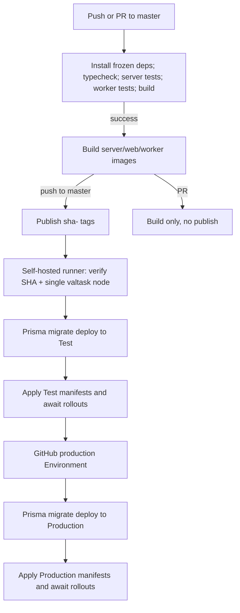

# CI/CD pipeline

The single workflow is `.github/workflows/ci.yml`, triggered by pushes and pull requests to `master`.

## Sequence and gates

1. CI uses GitHub-hosted Ubuntu, pnpm action, Node 24 and frozen lockfile. It runs `pnpm check-types`, server tests, worker tests, and `pnpm build`.
2. Packaging builds three Docker images from root context and service Dockerfiles. Only push-to-master logs into GHCR and pushes tags `ghcr.io/valatras/clichy-{server,web,worker}:sha-${GITHUB_SHA}`. Pull requests build without publishing.
3. Test deploy runs on a self-hosted Linux runner. It requires checked-out SHA to equal workflow SHA and exactly one cluster node named `valtask`. It applies monitoring manifests, runs `deploy.sh test sha-...`, and reports resources even on failure.
4. Production depends on CI, package, and Test deploy; uses GitHub Environment `production`, then runs the same exact-SHA checks and deploy script for `prod`.
5. `deploy.sh` invokes migration first. If migration fails, application manifests are not applied. On success it renders the overlay with the SHA, applies it, then waits up to five minutes for server, web, and worker rollouts.

GitHub Environment review/approval is not configured in the YAML; it may be configured in repository settings. There is no separate human validation job, explicit Test smoke-test step, or automatic rollback job. A failing rollout stops the job, but rollback is an operator action. No zero-downtime demonstration is included.

## Migration workflow detail

`deploy.sh` first waits for the environment's CNPG Cluster to report Ready. `migrate.sh` verifies a clean checked-out migration/deployment source, verifies node `valtask`, reads the environment Secret's DATABASE_URL without printing it, port-forwards the CNPG `clichy-postgres-rw` Service to a loopback ephemeral port, performs a PostgreSQL protocol `SELECT 1`, then invokes `prisma migrate deploy` (or `prisma migrate status`). It unsets credentials and cleans up the port-forward. It runs before new app manifests, so migrations must be compatible with currently running code during that interval.
