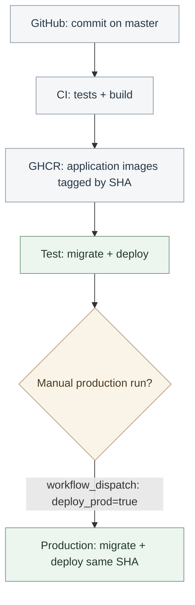

# CI/CD

**What is it?** GitHub Actions executes workflow jobs; GHCR stores OCI container
images. A self-hosted runner executes authorized deployment jobs on valtask.

**Why Clichy uses it** Tests and reproducible images precede deployment, with
one immutable `sha-<40-character-commit>` tag tying migrations and images together.

A push deploys Test after CI succeeds. To release, manually dispatch on the
chosen `master` commit: that run deploys Test again, then Production with the
**same SHA**, subject to any configured GitHub Environment approvals. PRs only
test/build; they never publish or deploy.

The single source is `.github/workflows/ci-cd.yml`. Pushes/PRs target `master`.
CI uses Node 24, pnpm's frozen lockfile, type checks, server/worker tests,
Citus migration integration tests in a disposable Docker container, healthcheck
regression tests and builds. Packaging builds the three application images; only master pushes or manual
dispatches publish images. The CNPG+Citus image build described by the target
architecture is not yet integrated into this branch’s workflow.

Test deploys automatically after successful CI/package. Production additionally
requires `workflow_dispatch` with `deploy_prod=true`, successful Test deployment
and GitHub Environment `production`. Approval rules are repository settings,
not guaranteed by the YAML. Pull requests never run on the deployment runner.
Jobs serialize deployments per environment. There is no automatic rollback or
end-to-end smoke-test gate.

## Runner setup

Register a non-root Linux runner using **Settings → Actions → Runners** and the
registration commands/token GitHub supplies. Give it labels `self-hosted, linux`,
install its service using the supplied `svc.sh`, and provide Node 24, pnpm,
`kubectl`, Git and access to GHCR and the cluster. Do not run untrusted PR code
with these credentials.

The workflow explicitly uses `KUBECONFIG=/home/valatras/.kube/config`.
The runner account must be able to read that protected kubeconfig; a different
account/path requires a deliberate workflow update. Keep mode 0600 and verify
access as the actual runner account. Runner credentials are distinct from each
namespace's `ghcr-pull-secret`.

Deployment checks the checked-out SHA, image tag and single node `valtask`.
The database workspace is installed from that same commit. Migrations run before
new application manifests; failed migrations stop deployment. See the
[deployment runbook](../operations/deployment.md) for operator commands.

Database preparation renders an immutable `18.6-citus14.2.0-sha-<commit>` image
separately from application rollouts. During transition, releases require the
manual database-architecture acknowledgement; see the [cutover runbook](../operations/deployment.md#controlled-cutover).
No pipeline job imports a database or silently selects the old Test CNPG dataset.
