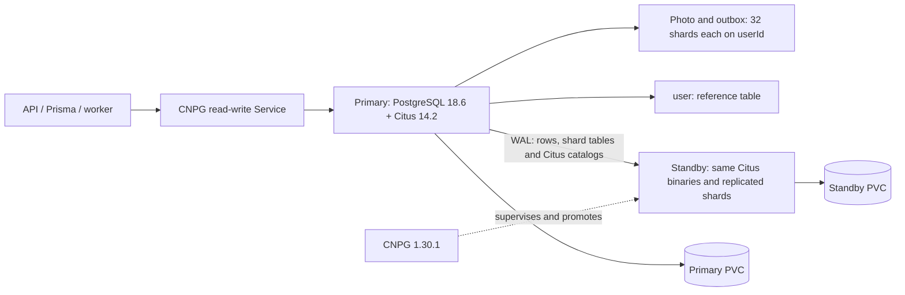

# PostgreSQL, Citus and CloudNativePG

**What is it?** PostgreSQL stores relational data; Citus adds logical hash shards.
CloudNativePG (CNPG) manages the PostgreSQL primary, standby and role Services.

**Why Clichy uses it** Test and Production target the same schema and topology:
32 photo/outbox shards inside one writable PostgreSQL instance, physically
replicated to a standby. This combines sharding and replication without worker groups.

## Architecture and rollout status

This is the **repository target**, not a claim that cutover already happened.
The operator's 2026-11-17 read-only output confirmed:

| Source | Observed state before cutover |
| --- | --- |
| Active Test | Standalone PostgreSQL 18.4/Citus 14.2; correct 32 colocated shards; zero users/photos/outbox rows |
| Existing Test CNPG | PostgreSQL 18.6, two streaming instances; a different database with one user/photo/outbox row and three migrations |
| Production | PostgreSQL 18.6, two streaming CNPG instances; no Citus; zero users/photos/outbox rows; single-column primary keys |

These databases are **not interchangeable**. Test import must preserve the old
CNPG database separately, including its migration history; never merge or overwrite
it based on the active Citus database's empty row count. The
[controlled procedure](../operations/deployment.md#controlled-cutover) is mandatory.

## Citus: logical sharding

**What is it?** Citus routes rows by a distribution key. Colocation aligns the
shard layout of related tables; reference tables support shared identity data.

**Why Clichy uses it** `Photo` and `PhotoProcessingOutbox` belong to users and can
share `userId` routing and foreign-key enforcement in both environments.

Each table uses `hash(userId)`, 32 shards and the same positive colocation ID.
`user` is a reference table (`n/t`, one shard). Compound primary/unique keys
include `userId`. Outbox references `Photo(userId,id)`; Photo-to-user delete is
RESTRICT, outbox-to-photo delete is CASCADE, and both FK updates are RESTRICT.
Images remain on the existing shared photos PVC. Existing coordinator-local
auth-table registrations can remain in Test; they are not hash shards and are
not converted or discarded.

Only the local coordinator (`localhost:5432`, group 0) stores shards. WAL copies
its catalogs and physical shard tables together. After promotion localhost means
the promoted instance, so no external worker addresses need rewriting. Application
connections use `clichy-postgres-rw`; do not point them at individual Pods.

## Image, initialization and Prisma

The Dockerfile under `infra/kubernetes/cnpg` pins the CNPG PostgreSQL 18.6 image
and official Citus 14.2 image by digest, on Debian 13/PG18. It copies extension
files rather than PostgreSQL executables, installs pinned libcurl and verifies
runtime linkage. CI tests it and publishes a PG-major-prefixed SHA tag.
This is a locally tested custom integration, not a vendor certification of Citus/CNPG.

CNPG preloads Citus first, enables 100 prepared transactions and creates the
extension through privileged bootstrap SQL on **fresh** clusters. Existing clusters
need the explicitly approved extension step in the runbook; bootstrap SQL is not
replayed on existing databases. The application role remains non-superuser.

Citus COPY and some parallel queries open internal connections. Loopback-only
`hostssl` rules authenticate the existing CNPG streaming client certificate with
explicit mappings to postgres/clichy. `citus.node_conninfo` verifies the server CA;
verify-ca is used because the endpoint is localhost, not a Service DNS identity.
External clients retain SCRAM. No passwords are copied into SQL or pgpass files,
and certificate rotation remains CNPG-managed. Actual CNPG certificate integration
still needs the Test checkpoint before Production.

Applied Prisma migrations are unchanged. New migration
`20261117140000_unified_cnpg_citus` aligns Production's legacy keys, backfills
nullable outbox owners, removes incompatible global uniqueness and registers
missing tables transactionally. Existing correct Test shards are only validated.
Unexpected metadata or orphan rows fail; no destructive conversion runs automatically.
Dev/local PostgreSQL remains plain PostgreSQL and skips this migration.

## Replication, failure and limits

**What is it?** Physical streaming replays WAL on a standby; promotion makes a
standby writable. Failover is recovery after failure, not a backup.

**Why Clichy uses it** CNPG maintains two instances and redirects its read-write
Service after promotion. Clients must reconnect; interrupted jobs may retry.

Two 2 GiB PVCs and the existing CPU/memory budgets are retained. Replication is
asynchronous: recent commits may be lost if the primary fails before replay.
All instances share valtask's disk/host; this is neither horizontal capacity
scaling nor node-level availability. K3s 1.37 remains outside CNPG 1.30's officially
supported matrix even though it is tested; the installer keeps its explicit gate.

Local disposable tests cover non-superuser SCRAM access, certificate-authenticated
Citus COPY, logical restore, streaming and native PostgreSQL promotion with unchanged
shard IDs and subsequent writes. **CNPG-managed failover on Kubernetes is not yet
verified.** The [healthcheck](../operations/scripts.md#healthchecks) observes configuration,
shards and active streaming; it deliberately skips failover testing.
A logical dump restores rows/schema/history, not Citus distribution metadata:
the target must be registered by the versioned migration after restore. Archives
already recording that migration need the explicit reviewed recovery step in the
runbook. Physical WAL replication preserves the target's catalog/shard IDs.
Coordinated database/photo backups and a restore rehearsal are prerequisites to cutover.
See [ADR 0009](../decisions/0009-unified-citus-cnpg.md) for the feasibility basis.
