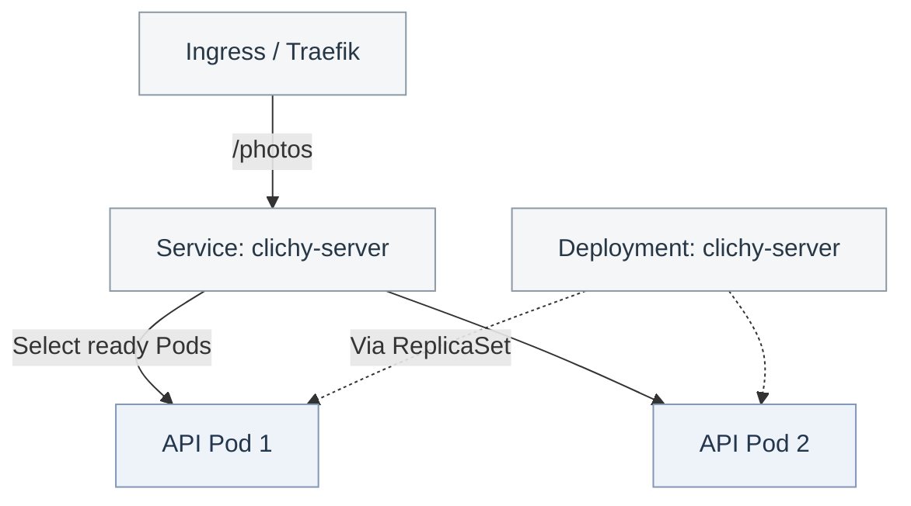

# Kubernetes and environments

**What is it?** Kubernetes schedules containers and manages Services, persistent
volumes and workload controllers. K3s packages it for a small server with
Traefik, local-path storage and Metrics Server.

**Why Clichy uses it** The same application manifests support namespace-specific
configuration, rollouts and scaling on the intentionally single-node `valtask`.

## Environments and resources

| Environment | Namespace | Application database | Storage |
| --- | --- | --- | --- |
| Dev | `clichy-dev` | CNPG | Local-path; local cluster |
| Test | `clichy-test` | CNPG + Citus target | Local-path |
| Production | `clichy-prod` | CNPG + Citus target | Retained local PVs on valtask |

`infra/kubernetes/base` defines Web/API/worker, Redis, photo storage and Ingress.
`overlays/{dev,test,prod}` customize hosts, image names, configuration and replica
counts. Their separate `database` subdirectories configure CNPG. Test/Production application
overlays deliberately exclude databases so a routine release cannot change a
database image. The old standalone Test manifests remain only for the pending
migration/rollback checkpoint and are no longer applied by deployment. Separate namespaces and Secrets are logical
isolation, not separate clusters or host-level availability.

## Deployment, Pods and Service



Solid arrows carry HTTP traffic; dotted arrows show management. The Deployment
maintains Pods through a ReplicaSet (omitted); the Service selects ready Pods by
label and keeps a stable address as Pods change. Two Pods illustrate scaling,
not a fixed replica count. Ingress routes `/photos` to the API Service.

## Prepare a server

These steps modify a host/cluster; review scripts before running them. No
installation command is needed for normal local application development.

1. Prepare Ubuntu Server 24.04 with hostname `valtask`, working SSH and a mounted
   `/srv/clichy` for Production. Install baseline tools using ordinary APT:

   ```bash
   sudo apt-get update
   sudo apt-get install --no-install-recommends ca-certificates curl git gnupg jq openssl python3 tar ufw
   ```

2. Configure Tailscale/MagicDNS and firewall policy. Verify `tailscale ping valtask`
   from an authorized client. Restrict ports 80, 3000 and 4466 to the intended
   private clients; existing UFW rules and SSH access require host-specific review.
3. Run `./infra/kubernetes/scripts/install-k3s.sh` as the non-root operator.
   It writes a mode-0600 kubeconfig, default `~/.kube/config-k3s`; set `KUBECONFIG`
   to it explicitly and inspect `kubectl get nodes`. It does not alter firewall/SSH.
4. Run `./infra/kubernetes/scripts/install-helm.sh` if Helm is absent. Then run
   `./infra/kubernetes/cnpg/install-operator.sh` before namespace preparation.
   The pinned K3s default is 1.37; the pinned CNPG installer treats that as tested
   but unsupported and requires the explicit `CNPG_ALLOW_TESTED_UNSUPPORTED_K8S=1`
   acknowledgement. Do not silently bypass this check.
5. Run `./infra/kubernetes/scripts/prepare-namespace.sh test` (and `prod` when
   preparing Production). The script confirms the target, generates/reuses local
   mode-0600 secret files under `~/.config/clichy`, normalizes the DB host/user,
   asks for GHCR read credentials, renders the database image for the checked-out
   published commit, creates isolated Secrets and waits for databases. For a fresh
   Test/Prod installation, apply Prisma migrations and acknowledge the validated
   architecture before the first application release. Existing environments must
   follow the [cutover runbook](../operations/deployment.md#controlled-cutover)
   instead of rerunning preparation to switch their Secrets early.
6. Install monitoring and optionally Headlamp with their scripts. Use
   `configure-lan-access.sh` for the Traefik admin ports; it refuses to overwrite
   conflicting Traefik values. See [scripts](../operations/scripts.md).
7. Configure the [self-hosted runner](ci-cd.md), then deploy through CI.

Namespace preparation can change Secrets; it is not a routine healthcheck.
Test uses `clichy-server-secrets`, Production `clichy-prod-secrets`; each namespace
also has `clichy-postgres-app` and `ghcr-pull-secret`. Never display their data
in logs or copy credentials between environments.

## Persistent storage

API and worker share the 10 GiB `clichy-server-photos` claim at `/data/photos`;
Redis has a 1 GiB claim. The old Test Citus claim remains retained for rollback. CNPG creates two separate
2 GiB claims per environment. Production pre-binds CNPG to local PVs under
`/srv/clichy/k3s-storage/prod/postgres-cnpg-{1,2}`, with UID/GID 26, node affinity
and `Retain`. Preparation refuses unsafe existing paths and requires the mount.

The old Production PostgreSQL PV/path remains reserved in the storage manifest;
removing the unused old StatefulSet source does not delete that live volume.
Do not delete/reuse it as part of normal deployment. `ReadWriteOnce` claims fit
this one-node design; monitor actual disk use, not just declared PVC capacities.
`Retain`, replicas and local-path storage are not backups.

The Dev overlay uses local `:dev` image tags; load locally built images into
your chosen cluster yourself. The `deploy.sh` entry point is intentionally
restricted to Test/Production on valtask.

## Portability

A cloud move would retain application images and namespace isolation, but replace
valtask-bound local PVs with provider storage and supply a shared photo volume
accessible to API/worker. Review ingress/DNS/tunnel endpoints, Secrets, runner
kubeconfig, node assumptions in deploy/migrate and CNPG storage classes together.
Restore a coordinated backup into an isolated environment and validate before
cutover. No cloud overlay or tested migration automation is provided.
