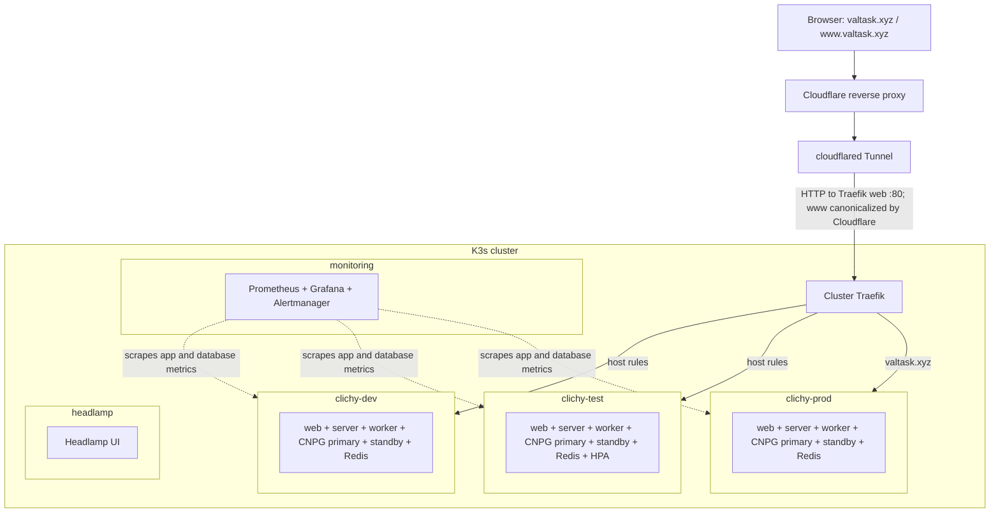

# Namespaces and service traffic

## Namespaces



Each `clichy-*` namespace contains independent workload Services, database, Redis, generated ConfigMaps, and environment Secrets. There is no data replication between namespaces. Monitoring ServiceMonitor/PodMonitor resources select all three environments; actual production metric visibility still depends on successful installation and scrape health.

Production's public route is proxied by Cloudflare for `valtask.xyz` and `www.valtask.xyz`, then enters through the Cloudflare Tunnel to Traefik; `www.valtask.xyz` redirects at Cloudflare to canonical `valtask.xyz`. The tunnel and redirect are external configuration and are not represented as Kubernetes resources in this repository.

`headlamp` has separate RBAC and Ingress manifests. The Monitoring/Headlamp manifests and scripts configure cluster tools; inspect their LAN hostnames and access policy before exposing them.

## Setup and inspection

```bash
infra/kubernetes/scripts/prepare-namespace.sh test
kubectl get all,pvc,ingress -n clichy-test
kubectl get secret -n clichy-test
```

Secret listing shows names only. Do not print Secret data into logs or paste it into documentation. The setup script asks for database and GHCR credentials and stores a local protected env file under `$HOME/.config/clichy`.
