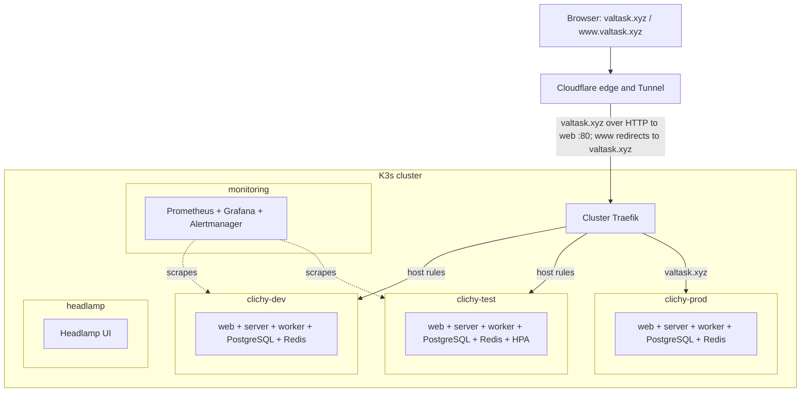

# Namespaces and service traffic

## Namespaces



Each `clichy-*` namespace contains independent workload Services, database, Redis, generated ConfigMaps, and environment Secrets. There is no data replication between namespaces. Monitoring's Clichy `ServiceMonitor` selects Dev and Test only; it does not scrape Production application metrics in this manifest. The Grafana dashboard can query namespace variables, but actual production metric visibility depends on the scrape configuration.

Production's public route enters through Cloudflare Tunnel to Traefik; `www.valtask.xyz` redirects at Cloudflare to the canonical `valtask.xyz` host. The tunnel and redirect are external configuration and are not represented as Kubernetes resources in this repository.

`headlamp` has separate RBAC and Ingress manifests. The Monitoring/Headlamp manifests and scripts configure cluster tools; inspect their LAN hostnames and access policy before exposing them.

## Setup and inspection

```bash
infra/kubernetes/scripts/prepare-namespace.sh test
kubectl get all,pvc,ingress -n clichy-test
kubectl get secret -n clichy-test
```

Secret listing shows names only. Do not print Secret data into logs or paste it into documentation. The setup script asks for database and GHCR credentials and stores a local protected env file under `$HOME/.config/clichy`.
