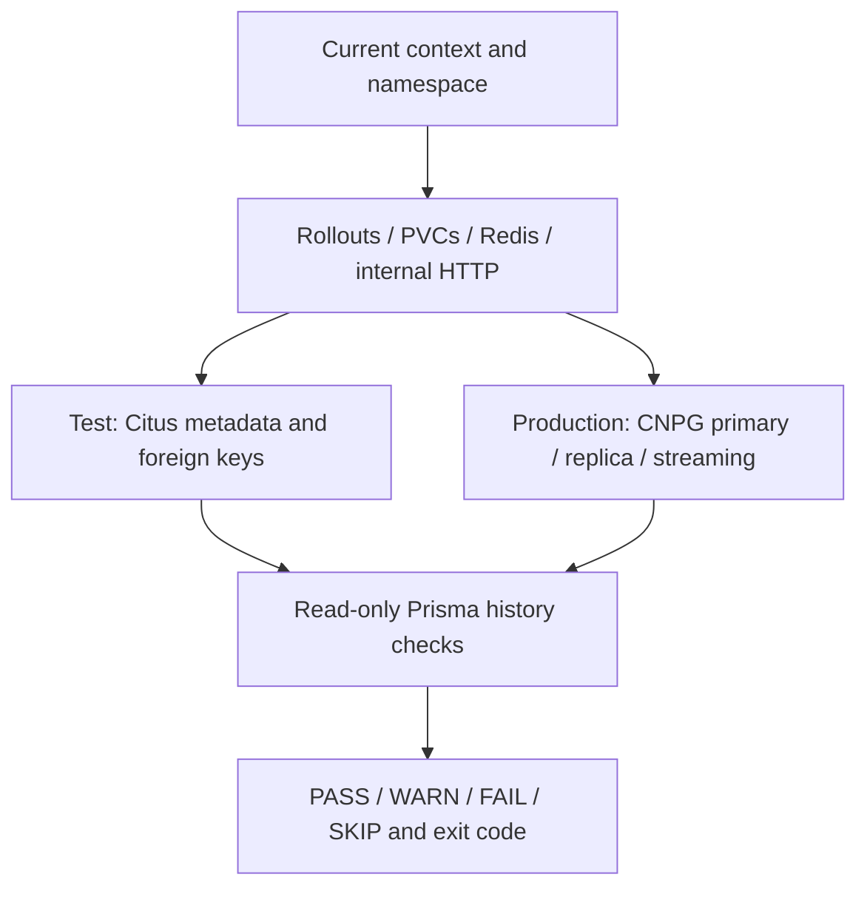

# Environment healthchecks

From the repository root, using the current Kubernetes context:

```bash
./infra/kubernetes/scripts/healthcheck.sh test
./infra/kubernetes/scripts/healthcheck.sh prod
./infra/kubernetes/scripts/healthcheck.sh test --verbose
```

Requires Bash, kubectl and GNU `timeout` (coreutils, already present on Ubuntu
and GitHub Ubuntu runners). No pnpm, local database client or Secret access is
required. Run from the commit whose migrations you expect in the environment.
The script never switches context; verify your selected kubeconfig beforehand.

| Scope | Observations |
| --- | --- |
| Both | Namespace access; API, Web, Worker and Redis rollouts; PVC binding and required photo/Redis claims; Redis PING; HTTP through the internal API Service; applied migration names and unfinished migrations |
| Test | Citus rollout and connectivity; reference `user`; hash distribution on `userId`, 32 shards for Photo and Outbox, colocation; validated foreign keys and expected update/delete actions |
| Production | CNPG Ready, primary and replica identification, PostgreSQL connectivity and a streaming standby on the primary; Citus explicitly skipped |

Each kubectl invocation has a 10-second request timeout and a 25-second outer
deadline, including exec streams. SQL sessions force read-only mode and a
10-second statement timeout. Total runtime can exceed 25 seconds because checks
run sequentially. Standard Kubernetes read/exec permissions are required.
SQL is executed with the existing database container's local authentication;
connection strings and Secrets are never retrieved. Raw subprocess output is
suppressed, including in verbose mode. Failures identify the check; investigate
permissions, readiness and connectivity using the linked diagnostic guides.

Output example (illustrative, not evidence from valtask):

```text
PASS Kubernetes namespace access
PASS Citus reference table, hash(userId), 32 shards and colocation
WARN Migration checks compare names only; checksum drift requires Prisma migrate status
Summary: PASS=20 WARN=1 FAIL=0 SKIP=0
```

Exit code `0` means no failed checks, including when warnings or intentional
skips are present; `1` means a failed check or missing dependency; `2` means invalid
arguments. Missing required components fail rather than passing as configured.
Migration names do not prove checksum equality or absence of extra migrations.
Use the separate `migrate.sh test status` / `migrate.sh prod status` diagnostic
when Prisma's full migration history comparison is needed; it reads a Secret
and opens a temporary port-forward but does not apply migrations.

The HTTP check exercises the API Service from an API Pod. Deployment readiness
covers Web and Worker probes; this is not an upload, authentication, queue
processing, public ingress, storage-write or end-to-end smoke test. Test CNPG
replication is separate from the application database; inspect it using the
[replication guide](../database/replication.md). Production streaming is observed
at check time, not a failover or data-loss guarantee.



Use [troubleshooting](troubleshooting.md) for detailed diagnostics,
[sharding](../database/sharding.md) for SQL inspection and the explicitly gated
historical recovery, and [known issues](known-issues.md) for incident history.
Recovery can change state and is never called by the healthcheck. The existing
load-test script creates application traffic and belongs to smoke/load testing.

Offline regression tests (fake kubectl, no cluster access):

```bash
node --test infra/kubernetes/scripts/healthcheck.test.mjs infra/kubernetes/citus/enable-user-sharding.test.mjs
```
