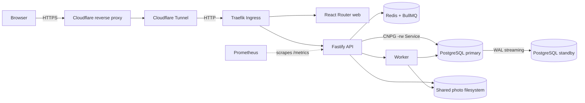

# Project overview

Clichy is intended to help users ingest, browse, and manage personal photo collections. The checked-in application currently supports account authentication, photo upload and listing, metadata retrieval, thumbnail derivatives, deletion, and server-side image processing. Similarity primitives exist, but a finished duplicate-review workflow and video support are not evident in the current source.

## Architecture at a glance

The API and worker mount the photo volume and share originals and derivatives. The API persists upload metadata and an outbox event; a dispatcher publishes queue jobs. The worker computes metadata, hashes, and derivatives.

## Technology stack

| Area | Repository evidence |
|---|---|
| Web | React, React Router, Vite, Tailwind CSS, shared `@clichy/ui` |
| API | Node.js, TypeScript, Fastify, Better Auth, multipart uploads |
| Processing | Sharp, Exifr, SHA-256, 64-bit perceptual hash, BullMQ |
| Data | PostgreSQL 18, Prisma 7, `pg` adapter |
| Queue | Redis 7.4, BullMQ 5, ioredis |
| Packaging | pnpm 12 workspace, Turborepo, Docker |
| Runtime | Kubernetes/K3s manifests, Kustomize, Traefik |
| Operations | GitHub Actions, GHCR, kube-prometheus-stack, Grafana, Headlamp |

Versions shown in manifests and package files are the repository's declarations and can differ from what is installed on a live host.

## Status summary

| Capability | Current repository status |
|---|---|
| Authentication and account persistence | Implemented; live operation not independently verified here |
| Photo upload, ownership checks, local filesystem storage | Implemented |
| Image metadata and derivatives | Implemented for JPEG, PNG, WebP, GIF |
| Exact and perceptual similarity primitives | Implemented; complete user-facing duplicate workflow not established |
| Video ingestion | Not implemented in inspected API pipeline |
| Kubernetes deployment | Manifests and scripts implemented; live state is not established by source review |
| Test then Production automation | Implemented in workflow; actual recent run status is not checked here |
| Database replication | CNPG configured in repository; not deployed or verified |
| Database sharding | Not implemented |
| Zero-downtime rollout | Intended by Deployment rolling update behavior, but not verified and replicas are one |

See [requirements traceability](requirements.md) and [roadmap](roadmap.md) for detail. Source locations are listed as repository-relative paths to make code review straightforward.
